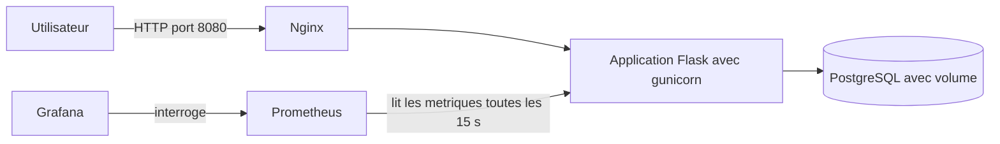

# Parc IT DevOps


Application web de gestion de parc informatique (équipements, statuts, affectations),
industrialisée avec une chaîne DevOps complète : conteneurs, CI/CD, infrastructure
as code et supervision.

## Stack

- Python 3, Flask, SQLAlchemy
- SQLite en local (PostgreSQL à partir de la semaine 2)
- pytest pour les tests
- Prometheus : métriques exposées sur `/metrics`

## Lancer en local

```bash
python -m venv .venv
source .venv/Scripts/activate      # Git Bash sous Windows
pip install -r app/requirements-dev.txt
cd app
python app.py
```

L'application est disponible sur http://localhost:5000
## Lancer avec Docker Compose

```bash
cp .env.example .env     # puis choisir un mot de passe dans .env
docker compose up -d --build
```

Trois services démarrent : Nginx (point d'entrée), l'application et PostgreSQL
(les données sont conservées dans un volume). L'application est disponible sur
http://localhost:8080

Pour arrêter : `docker compose down` (ajouter `-v` pour supprimer aussi les données).
## Lancer les tests

```bash
cd app
pytest -v
```

## Routes

| Route | Méthode | Description |
|---|---|---|
| `/` | GET | Page de gestion du parc |
| `/health` | GET | Vérification de santé |
| `/metrics` | GET | Métriques Prometheus |
| `/api/equipements` | GET, POST | Lister, créer |
| `/api/equipements/<id>` | GET, PUT, DELETE | Lire, modifier, supprimer |
## Architecture



Seul Nginx est accessible depuis l'extérieur. La base de données n'est jamais exposée,
et la page des métriques est fermée à l'extérieur : seul Prometheus, à l'intérieur du
réseau Docker, peut la lire.

## Sécurité

- Le conteneur tourne avec un utilisateur sans privilèges.
- Les versions des dépendances et des images sont figées.
- pip est retiré de l'image finale pour réduire la surface d'attaque.
- La CI scanne l'image avec Trivy et échoue si une faille grave corrigeable est détectée.
- Les secrets sont dans un fichier `.env` exclu de Git (modèle fourni : `.env.example`).

## Supervision

Prometheus collecte les métriques de l'application. Un tableau de bord Grafana, décrit
dans des fichiers versionnés, affiche la disponibilité, le débit de requêtes, le temps
de réponse moyen et les erreurs serveur.
## Feuille de route

- [x] Application Flask, API JSON et tests
- [x] Conteneurisation (Docker, Docker Compose)
- [x] Intégration continue (GitHub Actions)
- [ ] Infrastructure as Code (Terraform)
- [x] Supervision (Prometheus, Grafana)
- [x] Sécurité (Trivy)