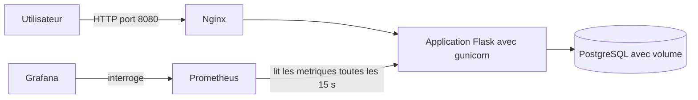

# Parc IT DevOps


Application web de gestion de parc informatique (équipements, statuts, affectations),
industrialisée avec une chaîne DevOps complète : conteneurs, CI/CD, infrastructure
as code et supervision.

## Stack

- Python 3, Flask, SQLAlchemy
- SQLite en local, PostgreSQL avec Docker Compose
- Authentification par sessions signées, mots de passe hachés (Werkzeug)
- pytest pour les tests
- Prometheus : métriques exposées sur `/metrics`

## Lancer en local

```bash
python -m venv .venv
source .venv/Scripts/activate      # Git Bash sous Windows
pip install -r app/requirements-dev.txt
cd app
export SECRET_KEY=une-cle-pour-le-developpement-local
flask --app app creer-utilisateur admin --role admin    # demande le mot de passe
python app.py
```

L'application est disponible sur http://localhost:5000 (connexion obligatoire).

## Lancer avec Docker Compose

```bash
cp .env.example .env
python -c "import secrets; print(secrets.token_hex(32))"   # copier le résultat dans SECRET_KEY
docker compose up -d --build
docker compose exec app flask --app app creer-utilisateur admin --role admin
```

Cinq services démarrent : Nginx (point d'entrée), l'application, PostgreSQL (données
conservées dans un volume), Prometheus et Grafana (ces deux derniers ne sont accessibles
que depuis la machine locale). L'application est disponible sur http://localhost:8080

Pour arrêter : `docker compose down` (ajouter `-v` pour supprimer aussi les données).

## Lancer les tests

```bash
cd app
pytest -v
```

## Routes

| Route | Méthode | Accès | Description |
|---|---|---|---|
| `/` | GET | connecté | Page de gestion du parc |
| `/export.csv` | GET | connecté | Export CSV de l'inventaire |
| `/login`, `/logout` | GET, POST / POST | public | Connexion, déconnexion |
| `/inscription` | GET, POST | public | Création d'un compte lecteur |
| `/ajouter`, `/modifier/<id>`, `/supprimer/<id>` | POST (GET pour modifier) | admin | Gestion depuis l'interface |
| `/audit` | GET | admin | Journal d'audit |
| `/health`, `/ready` | GET | public | Santé du service, état de la base |
| `/metrics` | GET | Prometheus | Métriques (fermée à l'extérieur par Nginx) |
| `/api/equipements` | GET / POST | connecté / admin | Lister / créer |
| `/api/equipements/<id>` | GET / PUT, DELETE | connecté / admin | Lire / modifier, supprimer |

## Architecture



Seul Nginx est accessible depuis l'extérieur. La base de données n'est jamais exposée,
et la page des métriques est fermée à l'extérieur : seul Prometheus, à l'intérieur du
réseau Docker, peut la lire.

## Authentification et rôles

L'accès est protégé par une connexion (session signée, durée de 8 heures).
Deux rôles existent :

| Rôle | Droits |
|---|---|
| `admin` | Lire, ajouter, modifier, supprimer, consulter le journal d'audit |
| `lecteur` | Lecture seule (et export CSV) |

Sans connexion, l'interface redirige vers `/login` et l'API répond `401`. Un lecteur qui
tente une modification reçoit `403`. Les routes `/health`, `/ready` et `/metrics` restent
accessibles pour la supervision.

**Inscription.** Toute personne peut créer un compte depuis la page de connexion. Ce compte
a toujours le rôle `lecteur` : on ne peut pas se donner le rôle `admin` soi-même. Le nom
d'utilisateur est unique sans tenir compte des majuscules, et le mot de passe fait au moins
8 caractères. Pour fermer les inscriptions, mettre `INSCRIPTION_OUVERTE=0` dans `.env`
(variable à transmettre au service `app` dans `docker-compose.yml`).

**Gestion des comptes en ligne de commande**, jamais dans le code :

```bash
docker compose exec app flask --app app creer-utilisateur NOM --role lecteur
docker compose exec app flask --app app changer-role NOM admin
```

Les mots de passe sont hachés (scrypt) et la clé de signature des sessions vient de
la variable d'environnement `SECRET_KEY`.

## Journal d'audit

Chaque action importante est enregistrée avec son auteur et l'heure (UTC) : connexion,
déconnexion, connexion échouée, inscription, ajout, modification (avec les valeurs avant
et après), suppression et changement de rôle. Un ajout refusé (doublon) n'est pas
journalisé, puisqu'il n'a pas eu lieu. Les administrateurs consultent les 200 dernières
entrées sur la page `/audit`.

## Sécurité

- Le conteneur tourne avec un utilisateur sans privilèges.
- Les versions des dépendances et des images sont figées.
- pip est retiré de l'image finale pour réduire la surface d'attaque.
- La CI scanne l'image avec Trivy et échoue si une faille grave corrigeable est détectée.
- Les secrets sont dans un fichier `.env` exclu de Git (modèle fourni : `.env.example`).
- Accès protégé par rôles (admin, lecteur), mots de passe hachés, aucun compte par défaut.
- L'application refuse de démarrer sans `SECRET_KEY`.
- Limitation des essais de connexion : 5 échecs par compte et par adresse (30 par adresse) en 15 minutes bloquent la connexion pendant le reste de la fenêtre, même avec le bon mot de passe.
- Les exports CSV neutralisent les formules (injection Excel et LibreOffice).

## Supervision

Prometheus collecte les métriques de l'application et évalue des règles d'alerte. Un
tableau de bord Grafana, décrit dans des fichiers versionnés, affiche la disponibilité,
le débit de requêtes, le temps de réponse moyen et les erreurs serveur.

## Feuille de route

- [x] Application Flask, API JSON et tests
- [x] Conteneurisation (Docker, Docker Compose)
- [x] Intégration continue (GitHub Actions)
- [x] Supervision (Prometheus, Grafana)
- [x] Sécurité (Trivy)
- [x] Authentification et rôles (sessions, admin/lecteur)
- [x] Inscription et journal d'audit
- [x] Limitation des tentatives de connexion
- [ ] Sauvegarde et restauration de PostgreSQL
- [ ] Découverte automatique du réseau
- [ ] Infrastructure as Code (Terraform)